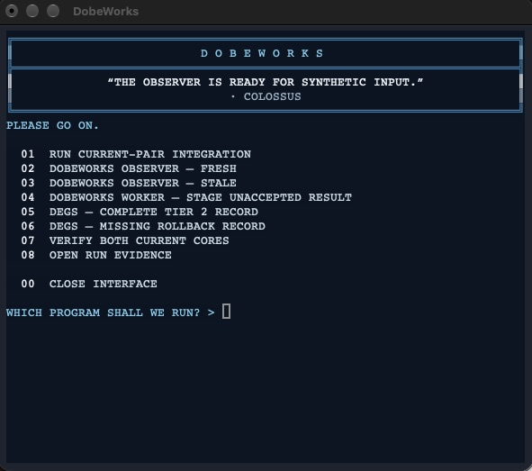

# DEGS



DEGS checks whether an engineering task's recorded evidence satisfies its governance rules and explains what is missing. It runs locally with Python 3.9 or later; no Python packages, model account, or API key are required.

## Try the gate

```sh
git clone https://github.com/tmccoy678/DEGS.git
cd DEGS
python3 -B bin/engineering-gate.py explain fixtures/tier2-complete-pass.json
python3 -B bin/engineering-gate.py explain fixtures/tier2-missing-rollback-blocked.json
```

The first example passes; the second blocks because recovery evidence is missing. Add `--json` for machine-readable output. `validate` checks a record's structure; `evaluate` and `explain` check readiness. A passing record does not authenticate its evidence, authorize work, or execute the task.

For the blue terminal interface shown above, follow [DobeWorks's setup instructions](https://github.com/tmccoy678/DobeWorks#start-here). Both repositories share that one interface.

[Gate contract](ENGINEERING_GATE.md) · [Task template](templates/engineering-task.json) · [Numeric input policy](docs/numeric-input-policy.md)

## Initial release

This release contains the standalone evidence gate, canonical task schema, synthetic fixtures, tests, documentation, and a small Sashiko-derived Python review-data component. Its Git tag is `initial-release-final`. Existing policy, schema, phase, and benchmark numbering remains unchanged.

The Sashiko component preserves supplied concerns and selected review state. It does not run an LLM investigation or a live software engineering agent. Try it with `python3 -B -m sashiko_derived.demo`; see its [scope](docs/port-boundaries.md) and [source provenance](provenance/sashiko-source.json).

The current tree also exposes those selected value operations through
`bin/review-state.py`. The command accepts bounded agent-supplied stage outputs,
stage-stamps and aggregates their concerns and dismissals, and returns
`NONE_REPORTED` or `UNRESOLVED_REPORTED`. These are report states, not semantic
review or candidate-acceptance decisions. The DobeWorks governed live-worker
uses the command through an exact-identity boundary.

## Evidence and documentation

The [current correction record](docs/reviews/2026-10-21-warning-input-fixes.md) records 102 passing tests on Python 3.14.7, 101 passes and one interpreter-specific skip on Python 3.9.6, and five benchmark tests. The [schema-helper benchmark](benchmarks/benchmark.md) matched 241 selected cases with controls passing. These are bounded observations for the recorded source and environment.

Run the core and port suite with:

```sh
python3 -B -m unittest discover -s tests -v
```

- [Original line-by-line core review](docs/reviews/agentverify-2027-degs-core/README.md) and [correction scope](docs/reviews/2026-10-21-warning-input-fixes.md), including the remaining approval-policy finding
- [Illustrated system guide](docs/figures/README.md)
- [References](references/engineering-foundations-references.pdf), [verification audit](references/verification.md), and [citations](CITATIONS.md)

Private activation history, context-skill integration, and the Workbench adapter are excluded from this standalone release. [Baseline scope](provenance/degs-baseline.json)

## From Taylor

I will briefly introduce Dobeworks and DEGS. First, DobeWorks and DEGS were originally intended for personal-use after I became quite obsessed with LLM hallucinations and developing a way to perform auditable context transfer between windows for Codex and OpenAI models in August, 2026.

I am aware that it is impossible to eliminate errors. It follows then that DobeWorks and DEGS do not try to fix errors; and one strength of the systems is their ability to prevent errors from moving forward into the next ticket or part of the work.

DobeWorks and DEGS are my personal engineering system for methodological systems, software, research infrastructure, and special projects.

If you would like to discuss DobeWorks and/or DEGS privately, please email me at: tmccoy678@gmail.com.

Thank you,

Taylor

Muchun Song introduced Sashiko's dismissed-concern collection and concern/dismissed-concern conflict resolution. Credit also goes to the Sashiko contributors and Chris Mason's separate review-prompts foundation. [Exact contributions and licensing](THIRD_PARTY_NOTICES.md) distinguish those roles.

Existing DEGS material retains [MIT](LICENSE). Sashiko-derived files and reference prompts retain [Apache-2.0](LICENSES/Apache-2.0.txt), with notices and modifications identified separately. Use [issues](https://github.com/tmccoy678/DEGS/issues) for non-sensitive questions and [SECURITY.md](SECURITY.md) for vulnerability reporting.
