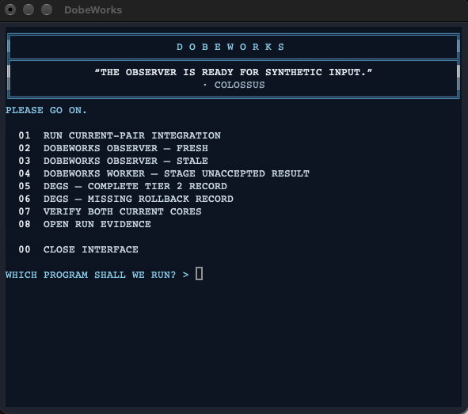

# DEGS — v2.1 



I will briefly introduce Dobeworks and DEGS. First, DobeWorks and DEGS were originally intended for personal-use after I became quite obsessed with LLM hallucinations and developing a way to perform auditable context transfer between windows for Codex and OpenAI models in August, 2026.

I am aware that it is impossible to eliminate errors. It follows then that DobeWorks and DEGS do not try to fix errors; and one strength of the systems is their ability to prevent errors from moving forward into the next ticket or part of the work.

DobeWorks and DEGS are my personal engineering system for methodological systems, software, research infrastructure, and special projects.

If you would like to discuss DobeWorks and/or DEGS privately, please email me at: tmccoy678@gmail.com.

Thank you,

Taylor

## Figures and references

[Read the illustrated system guide](docs/figures/README.md) for the relevant PDF figures and reflowable HTML equivalents. The [44-work APA reference edition](references/engineering-foundations-references.pdf) includes a [source-verification audit](references/verification.md).

## Public-data benchmark

**The current v4 benchmark matched 241 of 241 cases, with controls passing. All 14 historical false acceptances remain rejected; the first run is preserved.** See [benchmark results and reproduction](benchmarks/benchmark.md).

DEGS evaluates engineering task records and explains whether their recorded evidence satisfies its rules. Missing recovery evidence or an agent's claimed human approval can block a task. A passing result does not prove the evidence true, approve the work, or execute it.

**Public development snapshot. No versioned release.** This copy contains the standalone evidence gate and a small, Sashiko-derived Python review-data component. The [boundary-fix record](docs/reviews/2026-10-20-boundary-fixes.md) separates the current input-validation work from historical comparator evidence. It does not activate governance on your computer.

## Shared interface

DEGS and DobeWorks share [one terminal interface hosted in DobeWorks](https://github.com/tmccoy678/DobeWorks-v2.1/tree/main/interface). Follow that setup guide to clone the two repositories alongside each other and open the blue Command Center shown above. It calls the existing core CLIs; DEGS needs no separate UI installation or core changes. The menu includes both DEGS examples, DobeWorks programs, a synthetic adapter mapping check, and core verification. Recorded evidence and passing demonstrations grant no execution authority.

## Try the gate

Use Python 3.9 or later. No pip packages are needed for the gate or Python tests. The repository is public; run these commands from this checkout's root. Exact tested interpreters and environments are recorded with the [current verification results](docs/reviews/2026-10-20-boundary-fixes.md).

```sh
python3 -B bin/engineering-gate.py evaluate fixtures/tier2-complete-pass.json --json
python3 -B bin/engineering-gate.py evaluate fixtures/tier2-missing-rollback-blocked.json --json
python3 -B bin/engineering-gate.py evaluate fixtures/tier3-agent-self-approval-blocked.json --json
```

The examples are synthetic records. Their approval and evidence fields are examples, not authorization for real work.

| Example | Expected and observed | What it demonstrates |
| --- | --- | --- |
| Complete Tier 2 record | `PASS`, exit 0 | The supplied record meets the evaluated requirements. |
| Missing rollback evidence | `BLOCKED`, exit 2; `DEGS-CFG-004` | Recovery evidence is required for this task. |
| Agent self-approval | `BLOCKED`, exit 2; `DEGS-RISK-003` | An agent's claim does not satisfy the human-approval requirement. |

Each result lists the unmet fields and rule IDs. A blocked example is a successful demonstration when blocking is the expected result. Invalid JSON is a separate input failure (`FAIL`, exit 4), covered by the test suite.

## Try the Sashiko-derived component

```sh
python3 -B -m sashiko_derived.demo
```

This demonstration preserves a supplied concern and a supplied dismissed concern in separate collections, with the producing stage attached. It performs no LLM investigation and makes no decision about which claim is true. The later collections remain empty because deduplication, conflict resolution, and verification have not run.

The Python port retains Sashiko's selected state names, independent list defaults, deep-copy behavior, and stage stamping. Its object adapter distinguishes omitted arrays from explicit null. The original deduplication and conflict-resolution prompts are included as **unmodified reference text**, not an operating review service. See [source provenance](provenance/sashiko-source.json), [port boundaries](docs/port-boundaries.md), and [credits](THIRD_PARTY_NOTICES.md).

## Understand the tests

```sh
python3 -B -m unittest discover -s tests -v
```

Current verification passes **79 core/port tests and five benchmark tests**, covering Python 3.14.7 and Python 3.9.6. Five new CLI regression methods cover typed and nonblank planning, recovery and containment controls, planned-record readiness, and whitespace/case variants of unknown data authority. The tests also retain checks for ordinary command input, required evidence, approval boundaries, recursive JSON equality, duplicate keys, invalid UTF-8, nonfinite JSON, excessive nesting, and malformed control values. Exact commands, outputs, source identities, and environments are in the [October boundary-fix record](docs/reviews/2026-10-20-boundary-fixes.md).

Historical source generations passed 64 tests in the [original port report](docs/test-report.md), 67 in the [v3 comparator verification](benchmarks/results/validation-v3.json), and 74 before the October boundary fixes. The original port report also records a historical **331-case Rust comparison**; that comparison was not rerun for these boundary fixes.

These results concern the recorded scenarios. They do not establish defect freedom, semantic truth, AI review accuracy, security certification, full-system integration, or support for other platforms. The [baseline manifest](provenance/degs-baseline.json) identifies the copied core. The [comparator correction record](docs/benchmark-correction.md) and [recursive-correction source identity](provenance/recursive-equality-correction.json) describe the historical comparator generation, when all 14 fixture CLI outputs were preserved. The October boundary-fix record identifies the current source separately. Local activation history, private audits, context-skill integration, and the Workbench adapter remain excluded, along with tests requiring those dependencies. The policy rules remain unchanged.

A historical independent source-code review by [Nova (Muse Spark, Meta), 2026-10-05](docs/reviews/2026-10-05-nova.md) re-ran that source generation under pytest (Python 3.12): **72 passed, 264 subtests passed, 0 failed**. No code was changed; no defects found in that review. One documentation note: the `PASS_WITH_WARNINGS` → exit 1 convention could be stated once in the module docstring.

## Purpose, credit, and help

The goal is rigorous, understandable evidence with a clear explanation when something needs attention. Taylor welcomes questions, corrections, and suggestions and will respond as quickly as possible; no response-time guarantee is promised. Use this repository's issues for non-sensitive questions. Follow [SECURITY.md](SECURITY.md) for vulnerability reports.

Muchun Song introduced Sashiko's dismissed-concern collection and concern/dismissed-concern conflict resolution. The implementation also credits the Sashiko contributors and Chris Mason's separate review-prompts foundation. [Exact contributions and licensing](THIRD_PARTY_NOTICES.md) distinguish those roles. [Citations](CITATIONS.md) explain the source and software-engineering literature behind the reporting format.

Existing DEGS material retains [MIT](LICENSE). Sashiko-derived files and reference prompts retain [Apache-2.0](LICENSES/Apache-2.0.txt), with notices and modifications identified separately. This is not a claim that every file has become Apache-2.0. Public v2.1 licensing, packaging, installation, and release acceptance remain unfinished.
